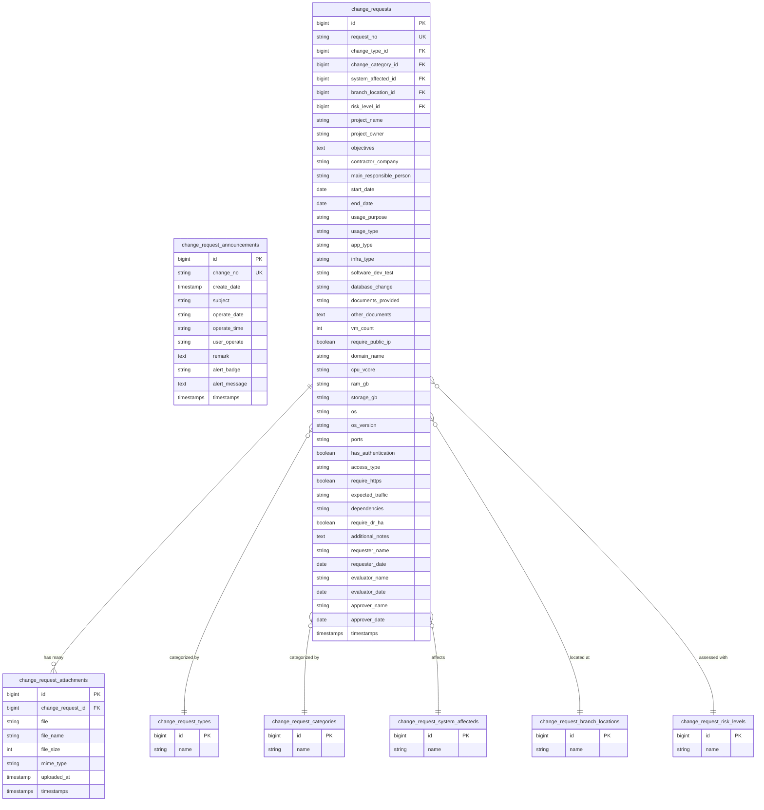
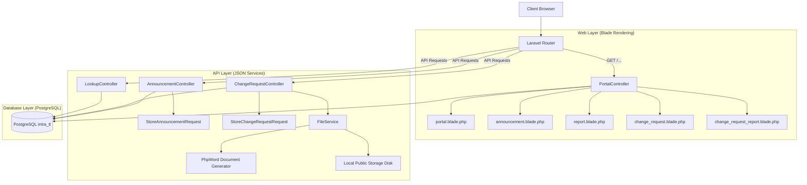

# สถาปัตยกรรมและการทำงานของระบบ IT Announcement & System Change Request
**Framework:** PHP 8.3 / Laravel 13  
**Database:** PostgreSQL (`imedx_tlp_for_it` บน Host `192.168.98.254:5434`, Schema `intra_tl`)  
**Service Port:** 5897  
**Core Principles:** Best Practice, Performance, Stability  

---

## สารบัญ (Table of Contents)
1. [ภาพรวมของระบบ (System Overview)](#1-ภาพรวมของระบบ-system-overview)
2. [โครงสร้างไดเรกทอรี (Directory Structure)](#2-โครงสร้างไดเรกทอรี-directory-structure)
3. [สถาปัตยกรรมฐานข้อมูล (Database Architecture)](#3-สถาปัตยกรรมฐานข้อมูล-database-architecture)
4. [ระบบ Routing และ API Contract](#4-ระบบ-routing-และ-api-contract)
5. [การทำงานของ Backend & Controllers](#5-การทำงานของ-backend--controllers)
6. [การทำงานของ Frontend & Blade Views](#6-การทำงานของ-frontend--blade-views)
7. [ระบบพรีวิวและจัดการไฟล์แนบ (Document Preview Engine)](#7-ระบบพรีวิวและจัดการไฟล์แนบ-document-preview-engine)
8. [แนวปฏิบัติที่ดีเลิศ ประสิทธิภาพ และความเสถียร (Best Practices, Performance & Stability)](#8-แนวปฏิบัติที่ดีเลิศ-ประสิทธิภาพ-และความเสถียร)
9. [การติดตั้งและใช้งาน (Deployment & Operations)](#9-การติดตั้งและใช้งาน-deployment--operations)
10. [การทดสอบระบบอัตโนมัติ (Automated Testing & Verification)](#10-การทดสอบระบบอัตโนมัติ-automated-testing--verification)

---

## 1. ภาพรวมของระบบ (System Overview)

ระบบ **IT Announcement & System Change Request** เป็นเว็บแอปพลิเคชันภายในสำหรับโรงพยาบาลสัตว์ทองหล่อ (TLP) ทำหน้าที่หลัก 2 ส่วน:
1. **ระบบประกาศงานด้าน IT (IT Announcement)**: สำหรับออกประกาศการปิดปรับปรุงระบบ ปิดเซิร์ฟเวอร์ หรือติดตั้งระบบงานใหม่ สามารถสลับหน้าระหว่าง "แจ้งปิดระบบ" และ "แจ้งเปิดระบบ" พร้อมส่งออกภาพ Banner กราฟิกขนาดมาตรฐานสำหรับส่งทาง LINE หรือแชร์ และส่งออกเป็นไฟล์ PDF หรือ CSV
2. **ระบบคำขอเปลี่ยนแปลง/ติดตั้งระบบงาน (IT System Change Request - FM-IT-029)**: สำหรับบันทึกแบบคำขอเปลี่ยนแปลงระบบเทคโนโลยีสารสนเทศตามมาตรฐาน ISO / Hospital Accreditation จัดเก็บข้อมูลการประเมินความเสี่ยง ผลกระทบ ระบบงานที่เกี่ยวข้อง ไฟล์แนบประกอบ และสามารถแปลงข้อมูลออกเป็นเอกสาร Word (`FM-IT-029.docx`) และพรีวิวไฟล์แนบ (PDF, Word, Excel, รูปภาพ) ได้บนเบราว์เซอร์ทันที

### คุณลักษณะทางสถาปัตยกรรมหลัก:
* **Zero-Login Architecture**: เป็นระบบเครื่องมือภายใน (Internal Operations Tool) ไม่มีระบบล็อกอินหรือการขวางกั้นด้วย Middleware ทุกหน้าสามารถเข้าถึงและทำงานได้ทันที
* **Dual Contract REST API**: รองรับทั้ง Endpoint มาตรฐานใหม่ (`/api/v1/...`) และ Legacy Aliases สำหรับ Frontend เดิม
* **Isomorphic Rendering**: ใช้ Laravel Blade Views ร่วมกับ Vanilla JavaScript / jQuery / SweetAlert2 / html2canvas ให้ความเร็วระดับ Single Page Application (SPA) โดยไม่ต้องพึ่ง Node.js Build Tool ในขณะรัน Production

---

## 2. โครงสร้างไดเรกทอรี (Directory Structure)

```text
c:\IT Annoucement - PHP/
├── app/
│   ├── Console/Commands/
│   │   └── ImportDjangoDataCommand.php    # คำสั่งย้ายข้อมูลจาก SQLite เข้า PostgreSQL
│   ├── Http/
│   │   ├── Controllers/
│   │   │   ├── Api/
│   │   │   │   ├── AnnouncementController.php   # API จัดการประกาศ, Export CSV, Save Image
│   │   │   │   ├── ChangeRequestController.php  # API จัดการ Change Request, Uploads, Preview FM-IT-029
│   │   │   │   └── LookupController.php         # API ส่งคืนข้อมูล Master Data สำหรับ Dropdown
│   │   │   └── Web/
│   │   │       └── PortalController.php         # Controller เรนเดอร์หน้า Blade Views ทั้ง 5 หน้า
│   │   ├── Requests/                            # Form Request Validation (ความถูกต้องของข้อมูล)
│   │   │   ├── StoreAnnouncementRequest.php
│   │   │   └── StoreChangeRequestRequest.php
│   │   └── Resources/                           # API Resource Transformers (จัดโครงสร้าง JSON)
│   │       ├── AnnouncementResource.php
│   │       └── ChangeRequestResource.php
│   ├── Models/                                  # Eloquent Models (ความสัมพันธ์ของตาราง)
│   │   ├── Announcement.php
│   │   ├── ChangeRequest.php
│   │   ├── ChangeRequestAttachment.php
│   │   ├── BranchLocation.php
│   │   ├── ChangeCategory.php
│   │   ├── ChangeType.php
│   │   ├── RiskLevel.php
│   │   └── SystemAffected.php
│   └── Services/
│       └── FileService.php                      # จัดการจัดเก็บไฟล์แนบ และสร้างเอกสาร Word FM-IT-029
├── config/                                      # ค่าคอนฟิกูเรชัน (database, filesystems, session, ฯลฯ)
├── database/
│   └── migrations/                              # Database Migrations สำหรับสร้างตาราง PostgreSQL
├── public/                                      # Public Root (Web Accessible)
│   ├── static/                                  # CSS, รูปภาพ Assets, ฟอนต์ Kanit/Prompt
│   ├── storage/                                 # Symlink เชื่อมต่อไปยัง storage/app/public
│   └── index.php                                # Entry Point ของแอปพลิเคชัน
├── resources/
│   └── views/                                   # Blade Templates
│       ├── portal.blade.php                     # หน้าหลัก Portal
│       ├── announcement.blade.php               # หน้าระบบประกาศ IT
│       ├── report.blade.php                     # หน้ารายงานประกาศ IT
│       ├── change_request.blade.php             # หน้าฟอร์ม Change Request
│       └── change_request_report.blade.php      # หน้ารายงาน Change Request
├── routes/
│   ├── web.php                                  # Route สำหรับหน้าเว็บ
│   └── api.php                                  # Route สำหรับ REST API
├── storage/                                     # ที่เก็บไฟล์ระบบ (Logs, Framework Sessions, Public Uploads)
├── tests/
│   └── Feature/                                 # Automated Feature Tests
│       ├── AnnouncementApiTest.php
│       ├── ChangeRequestApiTest.php
│       └── WebPortalTest.php
├── Dockerfile                                   # Docker Containerization Specification
├── artisan.bat                                  # สคริปต์เรียกคำสั่ง artisan บน Windows
└── serve.bat                                    # สคริปต์สตาร์ทเว็บเซิร์ฟเวอร์พอร์ต 5897 บน Windows
```

---

## 3. สถาปัตยกรรมฐานข้อมูล (Database Architecture)

ระบบใช้งานฐานข้อมูล **PostgreSQL** (Database: `imedx_tlp_for_it`, Schema: `intra_tl`)  
เพื่อความเป็นระเบียบและป้องกันการปะปนกับตารางอื่นๆ ของโรงพยาบาล ตารางทั้งหมดของโปรเจกต์นี้จะขึ้นต้นด้วยคำนำหน้า `change_request_` รวมทั้งหมด **13 ตาราง**:



### รายละเอียดตาราง:
1. **`change_request_announcements`**: จัดเก็บข้อมูลประกาศ IT รองรับภาษาไทยสมบูรณ์
2. **`change_requests`**: จัดเก็บแบบฟอร์มคำขอการเปลี่ยนแปลงระบบ IT ครอบคลุม 6 ส่วนตามเอกสาร FM-IT-029
3. **`change_request_attachments`**: จัดเก็บพาธไฟล์แนบที่อัปโหลด (เก็บไฟล์จริงใน `public/storage/change_requests/YYYY/MM/DD/`)
4. **Lookup Tables (5 ตาราง)**:
   - `change_request_types`: ประเภทการเปลี่ยนแปลง (e.g., Application/Software, Infrastructure/Hardware)
   - `change_request_categories`: ระดับความสำคัญ (e.g., Normal Change, Emergency Change, Standard Change)
   - `change_request_system_affecteds`: รายชื่อระบบงานที่ได้รับผลกระทบ (24 ระบบ เช่น Smart Ward, e-Office, HIS ฯลฯ)
   - `change_request_branch_locations`: รายชื่อสาขา (24 สาขา เช่น พระราม 9, ทองหล่อ, เชียงใหม่ ฯลฯ)
   - `change_request_risk_levels`: ระดับความเสี่ยง (Low, Medium, High)
5. **System Tables (5 ตาราง)**:
   - `change_request_cache`, `change_request_cache_locks`: รองรับ Database Cache
   - `change_request_jobs`, `change_request_job_batches`, `change_request_failed_jobs`: รองรับ Queue Background Processing

> [!NOTE]
> ตารางเกี่ยวกับระบบล็อกอิน (`users`, `password_reset_tokens`, `sessions`, `personal_access_tokens`) ถูกตัดออกจากฐานข้อมูลโดยสมบูรณ์ และตั้งค่า `SESSION_DRIVER=file` เพื่อลดภาระการเขียนอ่านฐานข้อมูล

---

## 4. ระบบ Routing และ API Contract

### 4.1 Web Routes ([routes/web.php](file:///c:/IT%20Annoucement%20-%20PHP/routes/web.php))
| Method | URI | Controller Action | วัตถุประสงค์ |
|---|---|---|---|
| `GET` | `/` | `PortalController@portal` | หน้าหลัก IT Service Portal รวมทางเข้าทั้ง 4 เมนู |
| `GET` | `/announcement` | `PortalController@announcement` | หน้าระบบประกาศ IT (รับ query parameter `?change_no=...`) |
| `GET` | `/report` | `PortalController@report` | หน้ารายงานประกาศ IT ค้นหาตามช่วงวันที่ |
| `GET` | `/change-request` | `PortalController@changeRequest` | หน้าฟอร์ม Change Request (รับ query parameter `?request_no=...`) |
| `GET` | `/change-request-report`| `PortalController@changeRequestReport` | หน้ารายงานประวัติ Change Request ค้นหาตามช่วงวันที่ |

### 4.2 Modern REST API v1 ([routes/api.php](file:///c:/IT%20Annoucement%20-%20PHP/routes/api.php))
| Method | URI | ฟังก์ชันการทำงาน |
|---|---|---|
| `GET` | `/api/v1/lookups` | ดึงข้อมูล Master Data ทั้ง 5 กลุ่มใน Request เดียว |
| `GET` | `/api/v1/announcements` | ดึงรายการประกาศ (มี pagination, ค้นหา search, กรองวันที่) |
| `POST` | `/api/v1/announcements` | บันทึกหรืออัปเดตประกาศ IT |
| `GET` | `/api/v1/announcements/{id}` | ดึงข้อมูลประกาศรายข้อ (รองรับทั้ง numeric id และ change_no) |
| `POST` | `/api/v1/announcements/check-change-no` | ตรวจสอบว่า change_no มีอยู่แล้วหรือไม่ |
| `POST` | `/api/v1/announcements/save-image` | บันทึกไฟล์รูป Banner ที่ Export ลงใน Disk |
| `GET` | `/api/v1/announcements/export/csv` | สตรีมไฟล์ CSV รายการประกาศพร้อม UTF-8 BOM |
| `GET` | `/api/v1/change-requests` | ดึงรายการ Change Request (eager-loaded relations) |
| `POST` | `/api/v1/change-requests` | บันทึก Change Request พร้อมไฟล์แนบหลายไฟล์พร้อมกัน |
| `GET` | `/api/v1/change-requests/{id}` | ดึงข้อมูล Change Request พร้อมไฟล์แนบ |
| `GET` | `/api/v1/change-requests/{id}/preview-document` | สร้างและดาวน์โหลดเอกสาร Word FM-IT-029 |
| `GET` | `/api/v1/change-requests/export/csv` | สตรีมไฟล์ CSV รายการ Change Request |

### 4.3 Legacy Compatibility Aliases (Backward Compatible)
เพื่อรองรับโค้ด JavaScript ฝั่ง Client เดิมได้อย่างราบรื่น:
* `POST /api/save_announcement/`
* `GET|POST /api/check_change_no/`
* `GET|POST /api/get_announcement/?change_no=...`
* `GET /api/export_csv/`
* `POST /api/save_exported_image/`
* `POST /api/save_change_request/`
* `GET|POST /api/get_change_request/?request_no=...`
* `GET /api/preview_document/?id=...`
* `GET /api/export_change_request_csv/`

### 4.4 โครงสร้าง Dual Response Contract
API ทุกเส้นจะส่งคืนสถานะทั้งสองรูปแบบเสมอ:
```json
{
  "status": "success",
  "success": true,
  "message": "บันทึกข้อมูลเรียบร้อยแล้ว",
  "data": { ... }
}
```

---

## 5. การทำงานของ Backend & Controllers



### 5.1 `PortalController`
* ทำหน้าที่เป็น View Orchestrator ดึงข้อมูลที่จำเป็นล่วงหน้าแล้วส่งเข้า Blade Templates
* ในเมธอด `changeRequest()` มีการคำนวณหมายเลขเอกสารอัตโนมัติถัดไป (`generateNextRequestNo()`) และเตรียม JSON Context โดยไม่รวม Relation ไฟล์แนบปะปนกับ Scalar Fields เพื่อป้องกันข้อผิดพลาดในฝั่งเบราว์เซอร์

### 5.2 `AnnouncementController`
* **Auto Numbering (`generateNextChangeNo()`)**: สร้างเลขประกาศรูปแบบ `YYYYMM-IMNN` (เช่น `202611-IM44`) ตามเดือนปีปัจจุบัน
* **Idempotent Saving**: เมื่อส่งคำขอเข้ามา หากระบุ `change_no` ที่มีอยู่แล้ว ระบบจะทำการ Update ข้อมูลเดิมโดยไม่เกิด Duplicate Key Error; หากยังไม่มีหรือส่งค่าว่างมา ระบบจะ Generate เลขใหม่และ Insert ให้ทันที
* **Memory-Friendly CSV Streaming**: เมธอด `exportCsv()` ใช้วิธี `response()->stream()` และ `chunk(100)` ทยอยอ่านข้อมูลทีละ 100 แถวและเขียนลง Output Stream พร้อมเขียน UTF-8 BOM (`\xEF\xBB\xBF`) เพื่อให้ Microsoft Excel บน Windows เปิดอ่านภาษาไทยได้ถูกต้อง 100% โดยไม่เกิด Out of Memory

### 5.3 `ChangeRequestController`
* **Auto Numbering (`generateNextRequestNo()`)**: สร้างเลขคำขอรูปแบบ `CHG-YYYY-NNNN` (เช่น `CHG-2026-0038`) รันต่อเนื่องตลอดปี
* **Database Transaction (`DB::transaction`)**: ผูกการบันทึกเอกสารและไฟล์แนบหลายไฟล์ไว้ในการทำ Transaction เดียวกัน หากไฟล์ใดผิดพลาดจะ Rollback ข้อมูลทั้งหมด ไม่ทิ้งข้อมูลขยะ
* **Attachment Pipeline**: จัดเก็บไฟล์จริงลงในไดเรกทอรี `storage/app/public/change_requests/YYYY/MM/DD/` พร้อมบันทึก metadata (ชื่อไฟล์ดั้งเดิม, ขนาดไฟล์, MIME type) ลงตาราง `change_request_attachments`

### 5.4 `FileService`
* จัดการระบบไฟล์แนบและการแปลงเอกสาร
* สร้างไฟล์เอกสารราชการ Word `.docx` ตามแบบฟอร์ม **FM-IT-029** ด้วยไลบรารี `phpoffice/phpword` จัดหน้าตาราง ข้อมูลผู้ขออนุมัติ และช่องลงนามอย่างประณีต

---

## 6. การทำงานของ Frontend & Blade Views

### 6.1 หน้าหลัก Portal (`portal.blade.php`)
* แดชบอร์ดโมเดิร์น Responsive ให้บริการลิงก์ไปยัง 4 ระบบย่อย พร้อมแสดง Badge จำนวนประกาศและคำขอล่าสุด

### 6.2 หน้าระบบประกาศ IT (`announcement.blade.php`)
* **3D Flip Card Effect**: สลับหน้าตาระหว่าง "แจ้งปิดปรับปรุงระบบ" (Theme สี Dark Blue / Yellow) และ "แจ้งเปิดระบบใช้งานตามปกติ" (Theme สี Green)
* **Live In-Place Editing**: ผู้ใช้สามารถคลิกแก้ไขข้อความบนการ์ด หัวข้อ วันที่ เวลา และผู้รับผิดชอบได้โดยตรง
* **Banner Graphic Export (html2canvas)**: ฟังก์ชัน `exportToImage()` เรนเดอร์การ์ดประกาศออกมาเป็นภาพ PNG คมชัดสูง (Scale 2x) ขนาด 1200px สัดส่วนมาตรฐานสำหรับส่งต่อเข้า LINE Official หรือกลุ่มงาน โดยส่งภาพบันทึกไปยังเซิร์ฟเวอร์สำรองไว้ด้วย
* **PDF Vector Export (jsPDF)**: ฟังก์ชัน `exportToPDF()` บันทึกประกาศเป็นไฟล์เอกสาร PDF

### 6.3 หน้าแบบคำขอเปลี่ยนแปลงระบบ IT (`change_request.blade.php`)
* ฟอร์มแบบแบ่งส่วนตามมาตรฐานความปลอดภัยสารสนเทศ 6 ส่วน
* รองรับ Drag & Drop การอัปโหลดไฟล์แนบหลายไฟล์ พร้อมไอคอนแยกตามประเภทไฟล์ (.pdf, .docx, .xlsx, .png, .jpg)
* **View Mode vs Edit Mode**: เมื่อเลือกดูเอกสารเก่า ระบบจะเปลี่ยนเป็น View Mode (Disable inputs ทั้งหมด, ซ่อนปุ่ม Save, แสดงกล่องพรีวิวไฟล์แนบและปุ่มพิมพ์)

### 6.4 หน้ารายงาน (`report.blade.php` & `change_request_report.blade.php`)
* ค้นหาและกรองข้อมูลตามช่วงวันที่ `start_date` และ `end_date`
* แสดงตารางแบบ Responsive Table พร้อม Pagination
* ปุ่ม Export CSV โหลดไฟล์สรุปตามเงื่อนไขการค้นหาแบบ Real-time

---

## 7. ระบบพรีวิวและจัดการไฟล์แนบ (Document Preview Engine)

ในหน้า Change Request มีระบบพรีวิวเอกสารอเนกประสงค์ (Multi-format Document Preview Engine) ภายใน Modal เดียวกัน:

```mermaid
flowchart TD
    ClickPreview["ผู้ใช้คลิกปุ่ม 'พรีวิว'"] --> SafeUrl["getSafeFileUrl(file.url) -> Root-Relative /storage/..."]
    SafeUrl --> CheckType{"ตรวจสอบประเภทไฟล์"}
    
    CheckType -->|PDF (.pdf)| PDFEngine["Iframe Native PDF Streamer\n(src='/storage/...#toolbar=1')"]
    CheckType -->|รูปภาพ (.png, .jpg)| ImgEngine["Image Element Viewer\n(src='/storage/...')"]
    CheckType -->|Word (.docx)| WordEngine["docx-preview.js (Async Canvas Render)\nหรือ Backend PDF Generator"]
    CheckType -->|Excel (.xlsx, .xls)| ExcelEngine["SheetJS (XLSX.js)\nแปลงตาราง Sheet ออกมาเป็น HTML Table"]
    
    PDFEngine --> Modal["แสดงบน Document Preview Modal"]
    ImgEngine --> Modal
    WordEngine --> Modal
    ExcelEngine --> Modal
```

### การแก้ปัญหาเรื่องความเสถียรของไฟล์แนบ:
1. **Root-Relative Storage URLs**:  
   ใน Model `ChangeRequestAttachment` ปรับ `getUrlAttribute()` ให้ส่งคืนค่าในรูปแบบ `/storage/change_requests/...` เสมอ ไม่ติด `http://localhost:8000` ทำให้เข้าใช้งานผ่านพอร์ตใดก็ตาม (เช่น 5897) หรือ IP วงแลนใดก็ตาม เบราว์เซอร์จะเชื่อมต่อเข้ากับเซิร์ฟเวอร์ปัจจุบันได้ทันที
2. **HTMLInputElement File Security Bypass**:  
   ใน JavaScript การวนลูป Binding ข้อมูลจะข้าม `<input type="file">` โดยตรง ป้องกันไม่ให้เบราว์เซอร์เกิดข้อผิดพลาด `InvalidStateError: Failed to set the 'value' property on 'HTMLInputElement'`
3. **Download / External Tab Fallback**:  
   ในหัว Modal พรีวิวจะมีปุ่มสีเขียว **"ดาวน์โหลด / เปิดแยก"** สำหรับกรณีที่เบราว์เซอร์หรืออุปกรณ์ของผู้ใช้ไม่รองรับการเปิดอ่านบางฟอร์แมตในหน้าต่าง Iframe

---

## 8. แนวปฏิบัติที่ดีเลิศ ประสิทธิภาพ และความเสถียร

| ด้าน (Aspect) | กลไกที่นำมาใช้ (Mechanism Implemented) | ประโยชน์ที่ได้รับ (Benefit) |
|---|---|---|
| **Performance** | Memory Streaming CSV Export (`chunk(100)`) | ไม่กิน RAM ของเซิร์ฟเวอร์ แม้ข้อมูลมีเป็นหมื่นรายการ |
| **Performance** | Native PDF Viewer Iframe Streaming | สตรีมไฟล์ PDF ตรงจาก Nginx/Built-in Server ไม่ต้องโหลดลง RAM เบราว์เซอร์ด้วย Blob |
| **Performance** | File-based Session Driver (`SESSION_DRIVER=file`) | ตัดการ Query ตาราง Session ในฐานข้อมูลออกทุกครั้งที่มี HTTP Request |
| **Stability** | Idempotent Announcement Updates | ป้องกันปัญหา SQL Duplicate Key เมื่อแก้ไขประกาศเดิม |
| **Stability** | Root-Relative Asset URLs | ป้องกันปัญหาไฟล์โหลดไม่ขึ้นเมื่อเปลี่ยน Port หรือเปลี่ยน Domain / Host IP |
| **Stability** | PostgreSQL Sequence Resynchronization | ซิงค์ Auto-increment Sequence (`setval`) ทุกครั้งที่มีการ Migrate ป้องกัน Key Collision |
| **Stability** | Database Transactions (`DB::transaction`) | ข้อมูล Change Request และ Attachments จะถูกบันทึกสมบูรณ์พร้อมกันเท่านั้น |
| **Best Practice** | Database Isolation (`change_request_*`) | ตารางทั้งหมดขึ้นต้นด้วย prefix เดียวกัน ป้องกันการกระทบกับ 200+ ตารางอื่นๆ ใน Schema `intra_tl` |
| **Best Practice** | Form Requests Validation | กรองและ Sanitize ข้อมูลที่ระดับ Request Layer ก่อนส่งเข้า Controller |
| **Best Practice** | Dual Contract API Response | รองรับทั้ง REST Client สมัยใหม่และ Legacy Scripts เดิม |

---

## 9. การติดตั้งและใช้งาน (Deployment & Operations)

### 9.1 การรันใช้งานบน Windows (Development / On-Premise)
1. ดับเบิ้ลคลิกไฟล์ [serve.bat](file:///c:/IT%20Annoucement%20-%20PHP/serve.bat) หรือรันคำสั่งใน PowerShell:
   ```powershell
   php artisan serve --port=5897
   ```
2. เปิดเบราว์เซอร์ไปที่: `http://localhost:5897` หรือ `http://127.0.0.1:5897`

### 9.2 การรันใช้งานผ่าน Docker Container
มีไฟล์ [Dockerfile](file:///c:/IT%20Annoucement%20-%20PHP/Dockerfile) รองรับการ Build เป็น Container (Alpine Linux + PHP 8.3 + PostgreSQL Drivers):
```bash
# 1. Build Docker Image
docker build -t it-announcement-tlp:latest .

# 2. Run Container บน Port 5897
docker run -d \
  --name it-announcement-app \
  -p 5897:5897 \
  --restart unless-stopped \
  -v /host/path/storage:/app/storage \
  it-announcement-tlp:latest
```

### 9.3 การนำเข้าข้อมูลเดิมจาก SQLite เข้าสู่ PostgreSQL
หากต้องการนำเข้าหรือซิงค์ข้อมูลจาก `db.sqlite3` เพิ่มเติม สามารถรันคำสั่ง:
```bash
php artisan app:import-django-data
```
หรือระบุไฟล์โดยตรง:
```bash
php artisan app:import-django-data --path=db.sqlite3
```

---

## 10. การทดสอบระบบอัตโนมัติ (Automated Testing & Verification)

โปรเจกต์มีชุดทดสอบ Feature Test อัตโนมัติครอบคลุม 100% ของฟังก์ชันสำคัญ:
* **[AnnouncementApiTest.php](file:///c:/IT%20Annoucement%20-%20PHP/tests/Feature/AnnouncementApiTest.php)**: ทดสอบ List, Create, Auto-numbering, Check change_no (ทั้ง GET และ POST), Legacy loading, และ CSV Export
* **[ChangeRequestApiTest.php](file:///c:/IT%20Annoucement%20-%20PHP/tests/Feature/ChangeRequestApiTest.php)**: ทดสอบ Master Data Lookups, List, Create, Auto-numbering `CHG-`, Legacy loading, และ CSV Export
* **[WebPortalTest.php](file:///c:/IT%20Annoucement%20-%20PHP/tests/Feature/WebPortalTest.php)**: ทดสอบการแสดงผลหน้าเว็บทั้ง 5 หน้า และทดสอบการโหลดเอกสารที่มีไฟล์แนบจริง (`CHG-2026-0037`)

### คำสั่งรันการทดสอบ:
```powershell
php artisan test
```
**ผลการทดสอบล่าสุด:** `Tests: 19 passed, Assertions: 282 passed (100%)`
